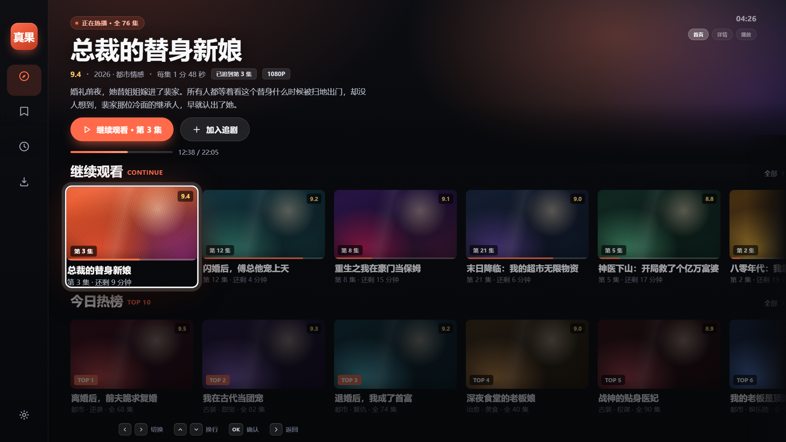
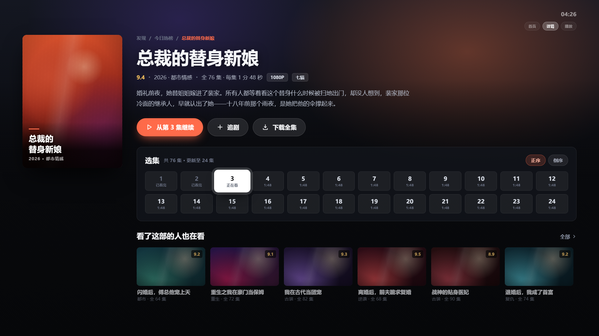
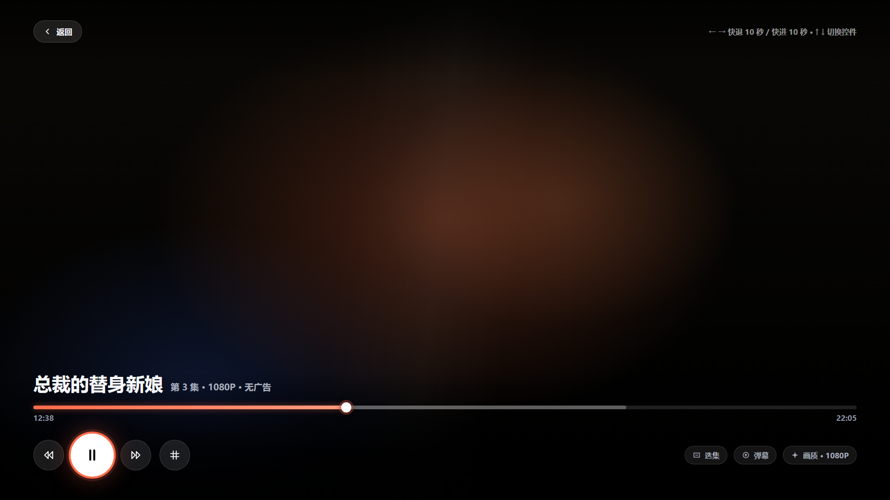

# 真果TV

**Android TV 短剧应用 · 遥控器全流程 · 大屏重制界面**

真果TV 是把短剧应用按 **10-foot UI**（3 米观看距离）重新设计了一遍的电视版：横屏锁定、电视桌面入口、焦点三重可辨、返回键分层防误退、搜索支持拼音输入法。站源的请求、解析、播放全部在设备本地完成，**没有任何自建服务器**。

> 基于开源项目 **guoapp**（原作者：鱼佬）改造的电视专用分支。非官方、非商业，仅供个人学习与技术研究。

**当前状态**：首页 / 搜索 / 播放 / 返回 / 下载 / 追剧主流程已在 TCL Android 11 电视（armeabi-v7a）实机跑通；`1.0.0` 的界面重制已通过静态检查与 CI 全量构建。

> **两端版本线各自独立**：电视端从 `1.0.0` 重新起版，手机端继续 `0.2.x`，两边各自发 Release、各自升级，互不影响。电视端版本号写在 `versions.json`，手机端沿用 `pubspec.yaml`。

---

## 这一版（电视端 1.0.0）改了什么

| 方向 | 内容 |
| --- | --- |
| **界面重制** | 画布压到 `#08090C`，缩略图从竖版海报改 **16:9 横版**（1080p 下一屏 3 张 → 5~7 张，远距可辨），左侧导航改浮动玻璃栏（收起 118px / 获焦展开 300px） |
| **焦点语言** | 获焦同时满足**缩放 1.065 + 3px 纯白环 + 提亮 1.1 + 珊瑚外发光**，三重叠加，客厅远距离不再靠猜 |
| **播放器** | 进度条 3→8px、拖拽钮 6→11、热区 14→22；音量条同规格 |
| **红果取流** | 移植**播放专用签名**（aid=8662 + Argus/Ladon 全套字段），详情、目录、取流全部恢复，实测拿到 1080p 直链 |
| **新站源** | 内建**七猫短剧**源，红果不可用时可直接切换 |

设计与实现规范见 [`design/design-contract.md`](design/design-contract.md)，浏览器里可交互验证的原型见 [`design/tv-redesign-v1.html`](design/tv-redesign-v1.html)（`←→↑↓` 移动焦点 / `Enter` 确认 / `Esc` 返回，等价遥控器）。

<b>展开看详情页 / 播放页设计稿</b>

---

## 下载与选包

到 **[Releases](https://github.com/serra006/guoapp/releases/latest)** 页下载，只装 **文件名带 `-tv-`** 的那个。

| 你的设备 | 选这个文件 |
| --- | --- |
| 大多数 Android TV / 电视盒子（64 位） | `zhenguojian-tv-*-arm64-v8a.apk` |
| 老款 32 位电视 / 电视盒子 | `zhenguojian-tv-*-armeabi-v7a.apk` |
| 模拟器 / x86 设备 | `zhenguojian-tv-*-x86_64.apk` |
| 手机 / 平板 | `zhenguojian-*-arm64-v8a.apk`（文件名不带 `-tv-`） |

**安装**：U 盘拷入 APK → 电视自带文件管理器打开安装。部分电视会自动清理下载目录里的 APK，建议装完即删。

- 不确定架构：先试 `arm64-v8a`，报架构不匹配再换 `armeabi-v7a`。
- `INSTALL_FAILED_NO_MATCHING_ABIS` = 架构选错了，换包即可。
- `INSTALL_FAILED_VERIFICATION_FAILURE` = 电视拦截了 adb 安装，改用文件管理器手装。
- 当前为 **debug 签名预览包**，同包名可直接覆盖升级，追剧记录与搜索历史保留。

包名 `com.duanju.zhenguo.tv`，与历史上的「红果鉴 TV」（`com.duanju.duanju_app.tv`）、「真果鉴 TV」（`com.duanju.zhenguojian.tv`）都不同，**三者可同时安装、互不覆盖**。因为是新包名，旧版的追剧记录不会自动带过来。

## 站源

内置 **13 个站源**，全部为 Go 原生 provider，随 APK 编译进 `.so`，不需要额外配置。

| 站源 | 内容 | 搜索 |
| --- | --- | --- |
| **七猫** | 短剧分类（18 类） | 标题匹配 + 分类回退 |
| **暴风** | 短剧大全等 49 个分类（苹果 CMS v10 接口） | 在线分页搜索 |
| **红果** | 真人剧、漫剧、AI 剧 | 在线搜索 + 官网联想 |
| 韩小圈 | 最新韩剧 / 韩国电影 / 韩国综艺 / 韩国动漫，多线路分集 | 在线搜索 |
| 鬼片 | 鬼片 / 电视剧 / 动漫，多线路分集 | RSS 标题匹配 |
| 青空 | 番剧、剧场动画、特摄 | 在线搜索 |
| 黄豆 | 精选短剧列表、VIP 标记 | 筛选已加载 |
| 剧果 | 热门 / 最新 / 接口分类 | 在线搜索，支持续页 |
| 野果 | 实际分类、目录、真实分集 | 在线分页搜索 |
| 帝果 | 网页分类、目录、分集 | 在线分页搜索 |
| 黄果视频 / 黄果 AI / 黄果旧版 | 列表、分类、详情、分集 | 筛选已加载 |

- **默认可见**：七猫、暴风、红果、韩小圈、鬼片、青空 —— 无需密码。
- 其余 7 个默认隐藏，在「站源管理」输入解锁密码后显示。
- 暴风有部分短剧把**整部剧合成一条 m3u8**（实测最长 2655 个分片 = 132 分钟 = 66 集），
  应用会按 120 秒切成逻辑分集再播；上游抖动时集数可能显示为「未知」，重进详情即可恢复。
  **它的定位是补充源**，稳定性不如七猫和红果。
- 可用性、清晰度与区域限制取决于源站及你的网络；应用不解除源站的 VIP 或其他授权限制。

## 电视端特性

| 特性 | 说明 |
| --- | --- |
| 遥控器全流程 | 方向键移焦、确认键激活、菜单键呼出「更多」，不依赖触屏 |
| 焦点三重可辨 | 缩放 + 白环 + 提亮同时生效；滚动容器内自动跟随，非焦点行整体压暗 |
| 返回键分层 | 播放中返回 → 剧集目录；目录页返回 → 提示「再按一次退出」，2 秒内再按才退出 |
| 拼音输入搜索 | 搜索框聚焦自动唤起系统拼音输入法；也可用左侧字母键盘按首字母联想 |
| 播放内核 | media_kit / libmpv 解码，支持红果的 CENC 加密流（ExoPlayer 系无法传解密密钥） |
| 亮度交给电视 | 播放页不接管屏幕亮度，由电视系统与遥控器管理 |
| 电视桌面入口 | 仅出现在 LEANBACK 桌面，横屏锁定，独立电视横幅 |

### 遥控器键位

| 按键 | 首页 | 详情页 | 播放页 |
| --- | --- | --- | --- |
| `←` `→` | 行内移焦 | 按钮/选集移动 | 快退 / 快进 10 秒 |
| `↑` `↓` | 换行 / 回到导航栏 | 换行 | 唤出 OSD 后上下切按钮 |
| `OK` | 进入详情 | 播放 / 激活 | 暂停 / 继续 |
| `Back` | 二次确认退出 | 返回首页 | 关 OSD → 回目录 |
| `Menu` | 卡片「更多」菜单 | — | — |

## 功能一览

| 功能 | 说明 |
| --- | --- |
| 浏览 | 排序与筛选、榜单、多选下载、展开搜索；分类独立一行；排序支持默认 / 名称 / 季号 / 上线日期 / 热度 / 播放量，可筛连载状态；接近底部自动翻页 |
| 搜索 | 红果合并官网与名称索引，停顿 10 条联想；支持全拼与首字母；最近 20 次按用户保存 |
| 推荐 | 红果「全部」后显示推荐，可切真人剧 / 漫剧 / AI 剧并分别记住位置 |
| 详情 | 封面、资料、追剧状态、可展开简介；底部固定「立即播放 / 继续播放」；选集每组 50 集，可切范围、定位当前、输入集数跳转；电视端资料与选集分栏 |
| 追剧与历史 | 想看 / 在看 / 已看 / 有更新筛选；每 5 秒及退出播放时记录真实进度 |
| 批量下载 | 菜单键打开卡片「更多」；标题栏「多选下载」一次最多 50 部 |
| 弹幕 | 红果在线播放默认开启，侧边「弹」字按钮可关、可看状态、可重试；本地播放不加载 |
| 下载 | 播放页「下载」Tab 与详情页入口均可选分集与画质；支持批量暂停 / 继续 / 重试 / 删除 |
| 更多 | 站源管理、用户管理、设置与备份、界面模式、关于 |

### 网络与资源设置

「设置与备份 → 网络与资源」可选自动 / 直连 / 手动代理（HTTP、HTTPS、SOCKS5、SOCKS5h）。代理地址默认遮蔽且不进入备份，设备内播放服务始终绕过代理。自动模式读取系统静态代理与排除列表，回复前台及每 30 秒刷新；**代理不会关闭 TLS 校验**。

目录请求并发 1–6、间隔 0–5000 ms（默认 3 / 250 ms）；下载并发默认 2、可设 1–6。

### 播放设置

手机 / 平板播放时默认保持屏幕常亮，避免系统按息屏超时把播放打断；可在「设置与备份 → 播放时保持屏幕常亮」关闭，关掉后跟随系统休眠设置。电视端不显示该项：电视接常电、系统不会按超时息屏。

### 局域网互联

两台设备同一局域网直连，自动同步追剧记录或接续播放，不依赖账号服务器。服务类型 `_zgj-link._tcp`（DNS-SD / mDNS），首次配对记录证书指纹。入口：「追剧 → 标题栏同步」或「设置与备份 → 设备互联」。

## 构建

工具链：Flutter `3.47.4`、Dart `3.12+`、Go `1.24.1+`、Python `3.10+`；Android 需 JDK 17、SDK 36、NDK `28.2.13676358`。

~~~sh
python3 scripts/build_android.py --flavor tv                  # 电视版（固定全站源）
python3 scripts/build_android.py --flavor tv --abi arm64-v8a
python3 scripts/build_android.py --flavor tv --cn-mirrors      # 国内镜像
~~~

手机上调试电视版：`flutter run --flavor tv --dart-define=TV_BUILD=true`（需先 `python3 scripts/build_native.py --platform android --abi <架构>` 编译核心）。

### CI 产物

推送 `main` / `master`、`v*` 标签、提交 PR，或手动运行 **Build app packages**，自动完成 `dart analyze` / `flutter test` / `go test -race` 并构建两个变体：

| Artifact | 内容 |
| --- | --- |
| `zhenguojian-tv-android` | 电视版三架构 APK + SHA256 |
| `zhenguojian-android` | 手机版三架构 APK + SHA256 |

发布阶段把两端拆成两个 Release，各带各的附件与校验清单：

| Release 标签 | 对应 | 版本来源 |
| --- | --- | --- |
| `tv-v1.0.0` | 电视版「真果TV」 | `versions.json` 的 `tv` |
| `app-v0.2.x` | 手机版「真果鉴」 | `pubspec.yaml` 的 `version` |

两端共用 `pubspec.yaml` 的 `+N` 构建号（决定 versionCode，必须只增不减，否则覆盖安装会被系统拒绝），但版本名各走各的：电视端由构建脚本传 `--build-name` 覆盖，手机端直接用 pubspec。

正式发布使用同一签名并递增构建号，需在仓库 Secrets 配置 `ANDROID_KEYSTORE_BASE64`、`ANDROID_KEYSTORE_PASSWORD`、`ANDROID_KEY_ALIAS`、`ANDROID_KEY_PASSWORD`；未配置时回退生成 debug 签名预览包。

本地不入库的 `android/key.properties`：

~~~properties
storeFile=/absolute/path/zhenguojian-release.jks
storePassword=你的密码
keyAlias=zhenguojian
keyPassword=你的密码
~~~

## 开发约定

**站源是 Go 原生 provider**（`native/core/provider_*.go`），不是运行期加载的脚本。新增站源需同时接入 5 处：

1. `provider_huangguo.go` —— 常量、白名单、来源规范化、分集接口
2. `provider_media.go` —— baseURL、host 反查、播放分派
3. `app_categories.go` —— 分类校验与拉取
4. `app_cover_metadata.go` —— 封面补齐
5. `app_runtime.go` —— 目录 / 搜索 / 详情分派、空页放行

最后在 `lib/models.dart` 登记 `SourceSite`，并同步 `test/source_gate_test.dart`、`test/app_build_test.dart` 里的站源数量断言。

**电视端注意事项**：

- 新增页面必须保证焦点可达：滚动容器包 `TelevisionFocusScroller`，列表项用 `TvTile` / `RemoteTarget` 壳。
- 不要用裸 `TextField` 在电视上弹系统键盘（搜索框除外，那里正需要拼音输入法）；表单输入走自建键盘组件。
- 返回逻辑统一走 `PopScope` + 全局返回处理，不要在页面里直接 `Navigator.pop` 或 `SystemNavigator.pop`。
- **字号的坑**：设计稿按 960dp 基准折算，但电视厂商 density 不统一（960dp 与 1920dp 都存在）。改字号一律通过 `MediaQuery.textScaler` 统一缩放，不要写死 `fontSize`，否则会在某类机型上突然变小。

## 目录结构

| 目录 | 内容 |
| --- | --- |
| `lib` | 页面、播放器、本地用户、FFI、下载与媒体处理 |
| `lib/design_tokens.dart` | 设计 token：色板 `TvColor`、密度与焦点参数 `TvSpace`、字阶 `TvText` |
| `native/core`、`native/bridge` | 独立站源核心、缓存、下载、目录迁移与 C ABI |
| `android` | 平台工程、TV flavor 与电视资源 |
| `design` | TV 端设计稿、设计契约与逐屏预览图 |
| `scripts`、`.github/workflows` | 构建、签名、验证、同步与版本快照 |
| `versions.json` | 电视端独立版本号（手机端仍读 `pubspec.yaml`） |
| `test`、`integration_test` | 自动化与设备回归 |
| `TV-CHANGES.md` | 电视端改造全量变更日志（含每次踩坑与实测数据） |

## 更新日志

版本节奏、修复细节与实测数据都记在 [`TV-CHANGES.md`](TV-CHANGES.md)，按时间倒序：

| 版本 | 主题 |
| --- | --- |
| 电视 1.0.0 / 手机 0.2.69 | 两端版本线拆开；修掉手机上被误伤的点击水波纹与粗进度条 |
| 0.2.68+75 | TV 端 UI 重设计 v1：深色画布 / 焦点三重可辨 / 横版卡片 / 浮动玻璃导航 |
| 0.2.67+74 | 红果播放真正修好：移植播放专用签名，详情 / 目录 / 取流全部恢复 |
| 0.2.66+73 | 内建七猫短剧源，红果不可用时可直接切换 |

## 来源与免责声明

源码来自网上开源的 **guoapp**（原作者：鱼佬），在 `0.2.64+71` 基础上做了电视端适配、站源补全与界面重制。

本项目仅用于个人学习与技术研究，**不保证可用性，随时可能停止维护**。所有内容版权归原站所有，本项目不存储任何视频资源，也不解除源站的 VIP 或其他授权限制。请勿用于商业用途。
